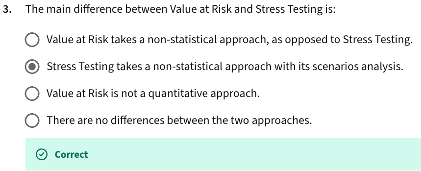

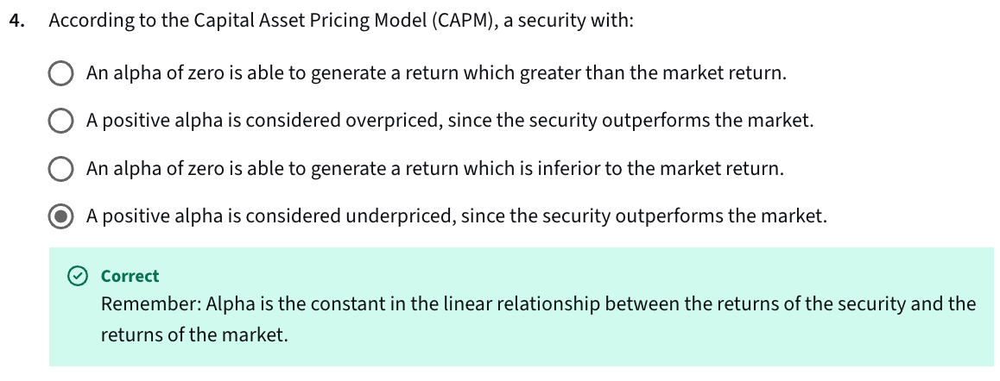

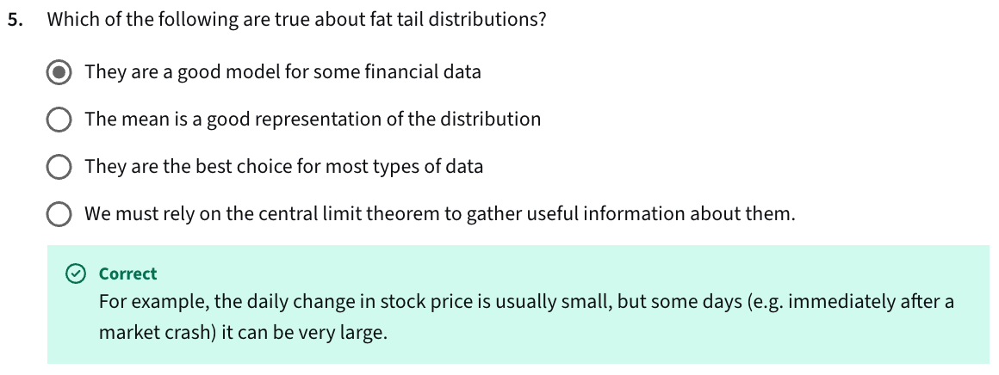

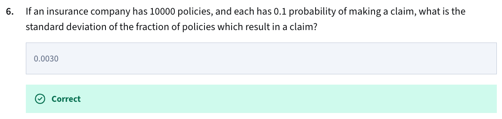

```python
import math

n = 10000  # Total number of policies
p = 0.1    # Probability of a single policy making a claim

# Calculate the variance of the fraction of policies (proportion)
variance_of_fraction = (p * (1 - p)) / n

# Calculate the standard deviation of the fraction of policies
std_dev_of_fraction = math.sqrt(variance_of_fraction)

print(f"The variance of the fraction of policies is: {variance_of_fraction}")
print(f"The standard deviation of the fraction of policies which result in a claim is: {std_dev_of_fraction:.4f}")

## --> 0.0030
```


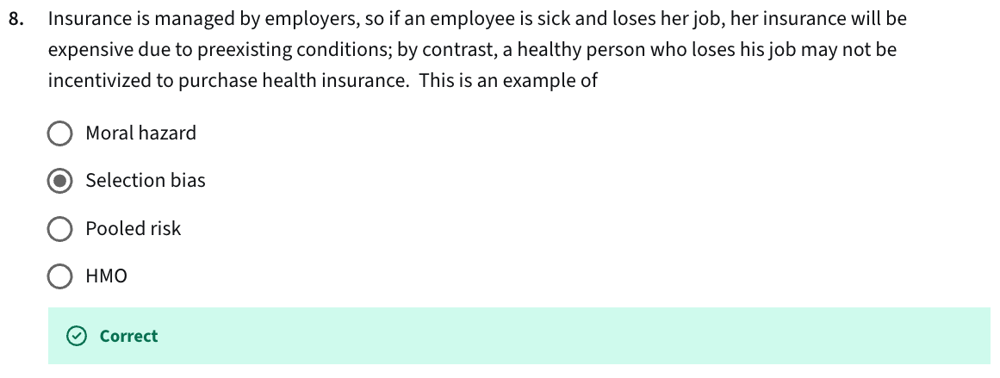

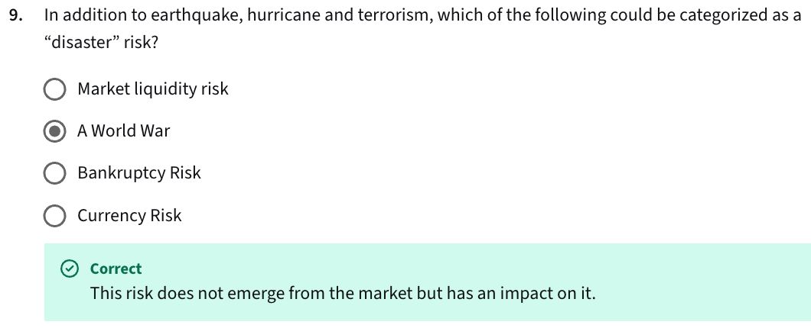

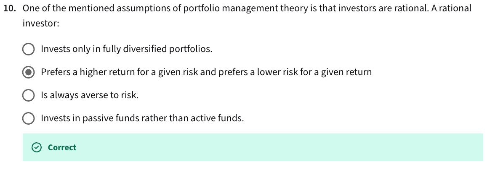

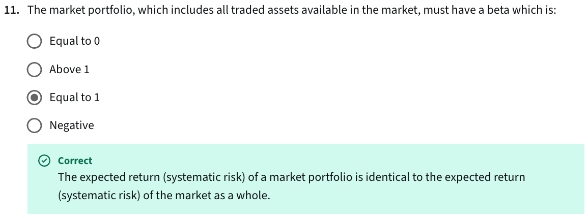

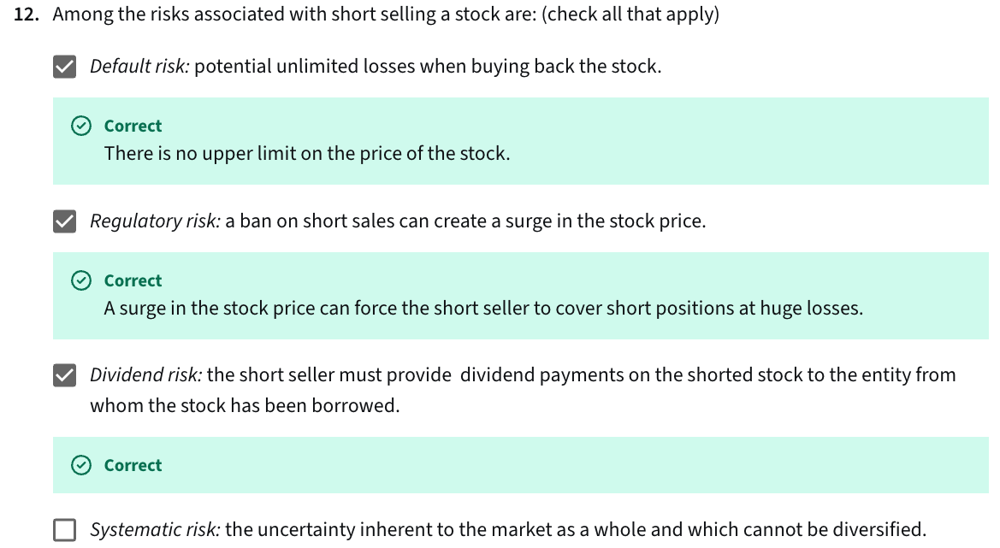

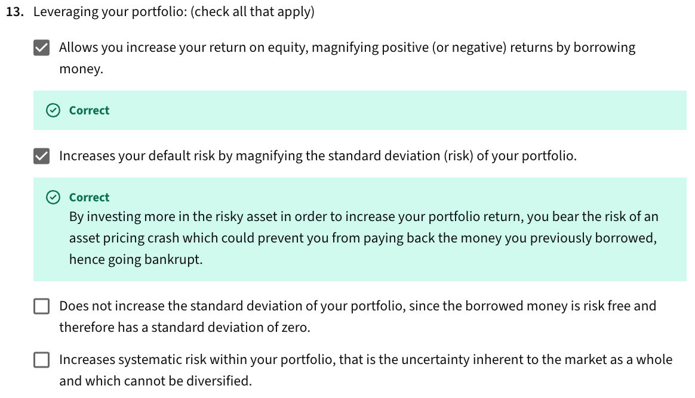

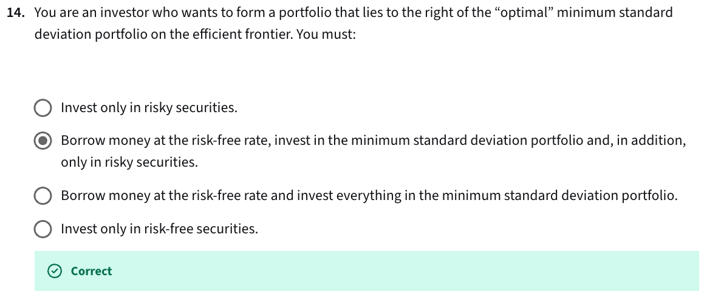


