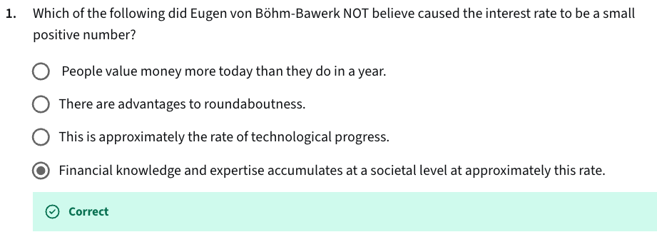

Eugen von Böhm-Bawerk, a classical Austrian economist, believed the positive interest rate arises from:
1. Time preference — people prefer present goods over future goods.
2. Roundaboutness — longer production processes (more "roundabout") are more productive.
3. Technological progress — helps make future production more valuable.

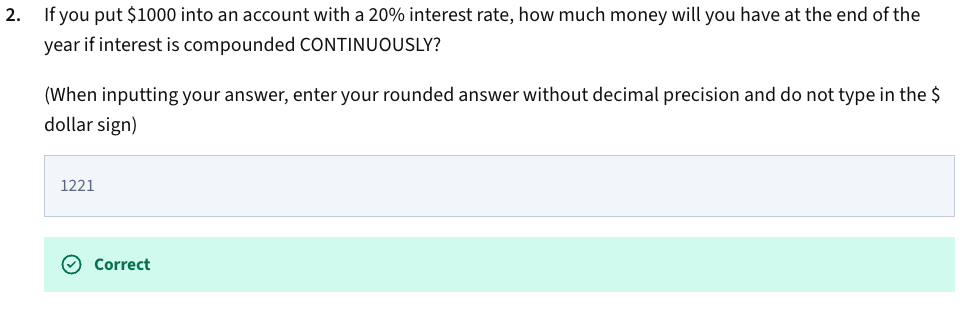

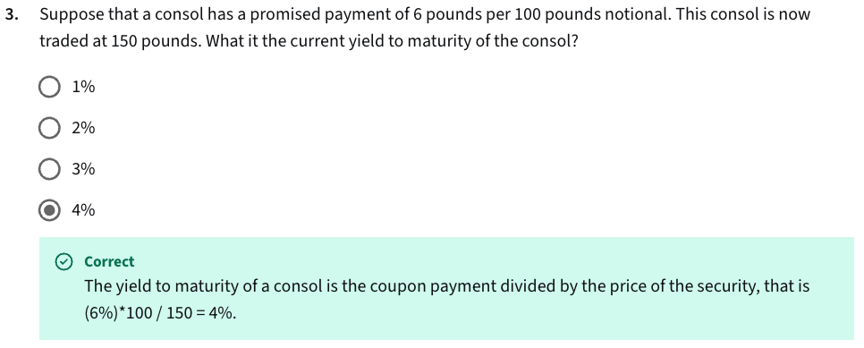

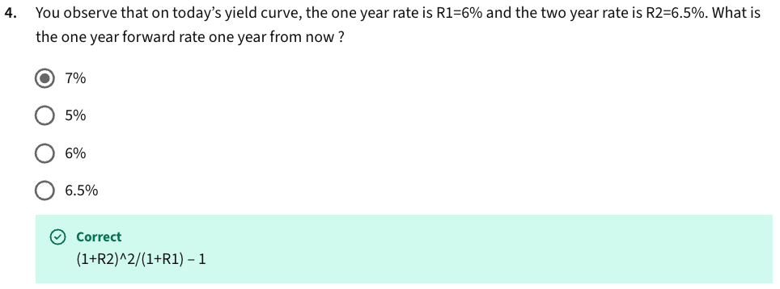

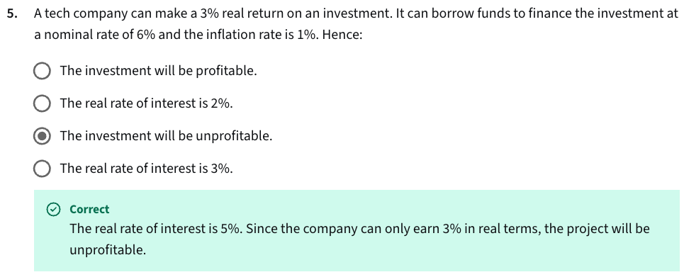

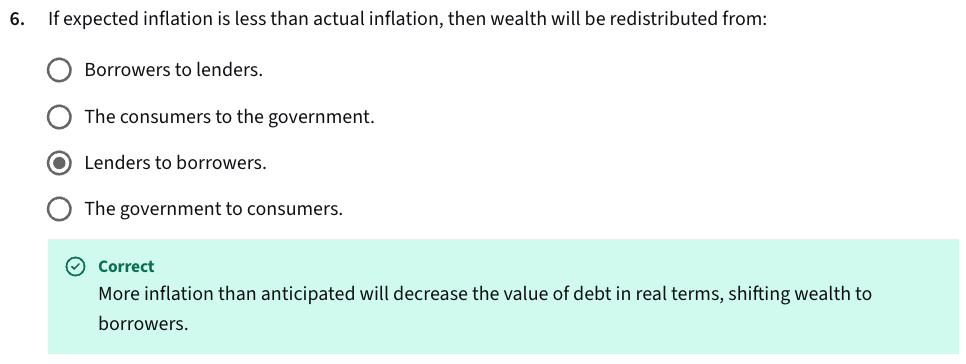

- Borrowers repay their loans in money that’s worth less than expected.
- Lenders receive payments that have less purchasing power.

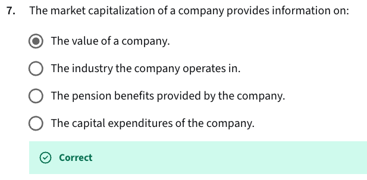

- If a stock splits (e.g., 2-for-1), each share is worth half as much, so the price per share drops proportionally.
- A split increases the number of shares (e.g., from 100M to 200M in a 2-for-1 split).
- Each shareholder owns more shares, but the same percentage of the company.

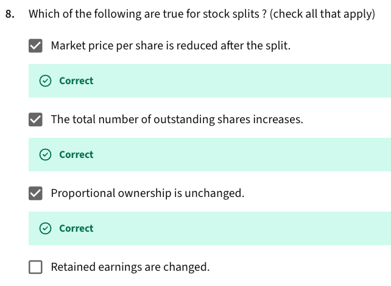

- Preferred stock adds to equity capital but typically does not have voting rights, so it doesn't dilute control of common shareholders.

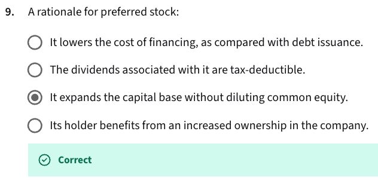

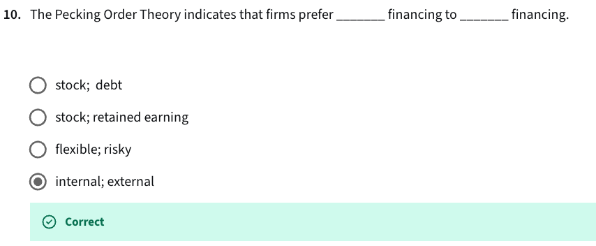

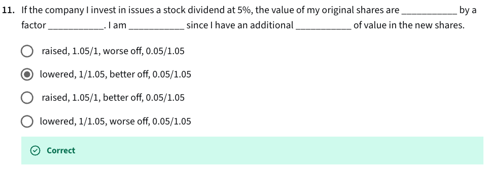

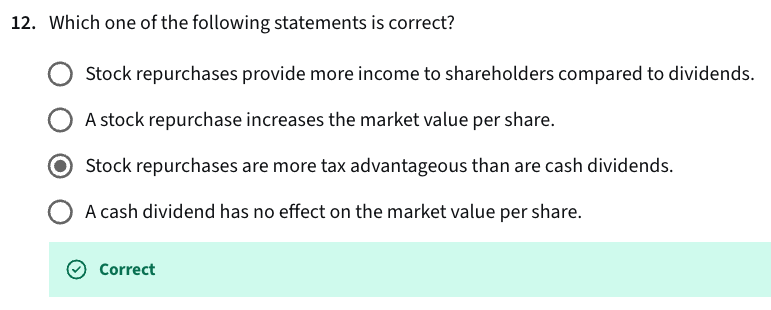

- Stock repurchases provide more income to shareholders compared to dividends.
  - Not necessarily — repurchases reduce share count, potentially increasing price, but don’t directly provide income unless shareholders sell.
- A stock repurchase increases the market value per share.
  - Not always — it may increase earnings per share by reducing share count, but market price per share may not rise unless fundamentals improve.
- Stock repurchases are more tax advantageous than are cash dividends.
  - Dividends are taxed immediately as income, while with repurchases, shareholders only pay capital gains tax if and when they sell.
- A cash dividend has no effect on the market value per share.
  - False - When a cash dividend is paid, the stock price typically drops by the dividend amount.

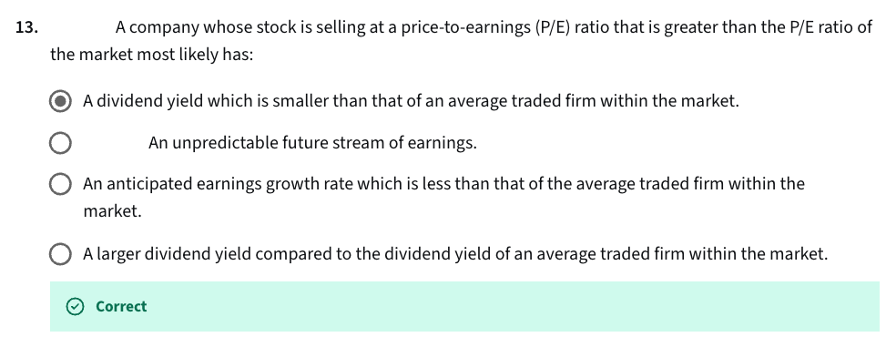

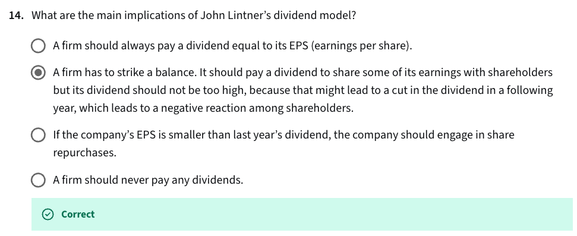
