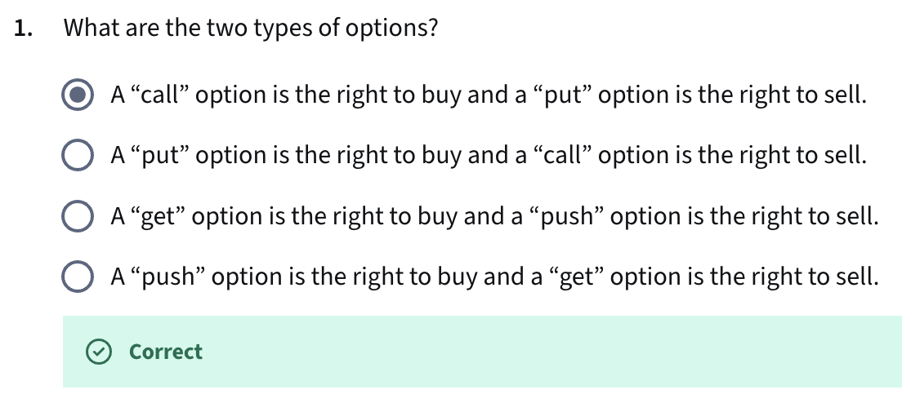
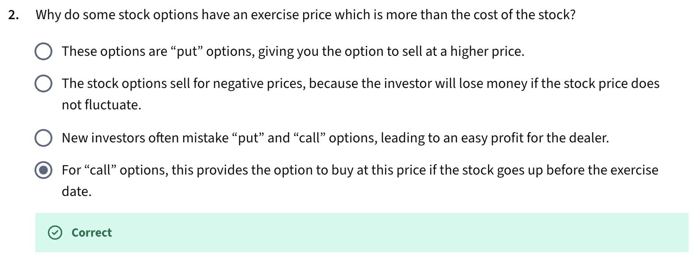
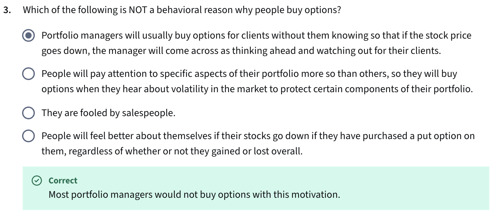
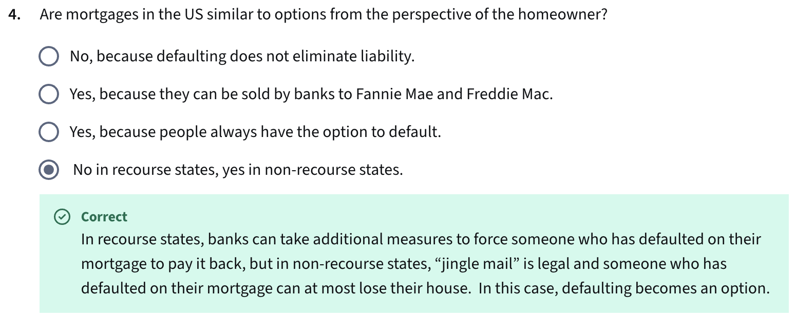
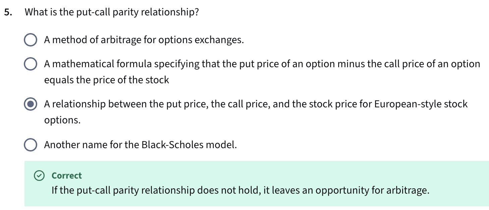
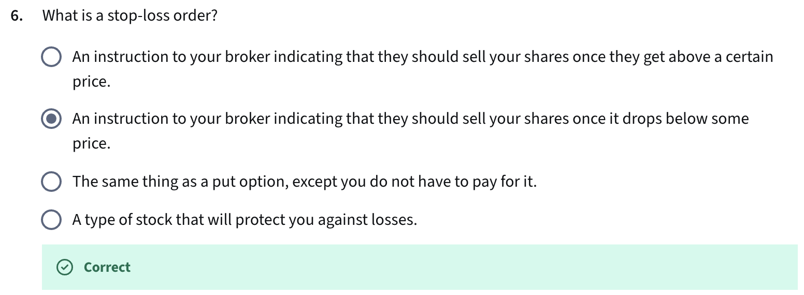

- That’s not a behavioral bias on the buyer’s part — it’s an action by the portfolio manager.

- In non-recourse states, the borrower can walk away (like exercising a put option) without further liability; in recourse states, the lender can pursue the borrower for the balance.

- Put-call parity is a no-arbitrage relationship linking European call and put prices with the underlying asset price and the risk-free bond value.

